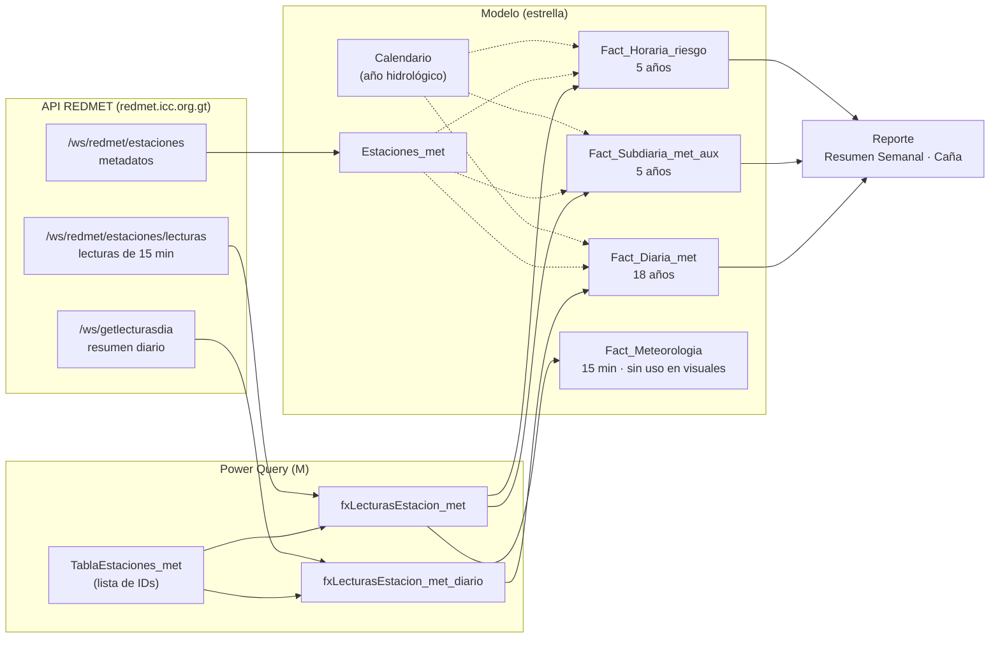

# Arquitectura del modelo

## Flujo de datos

Cada tabla de hechos llama a la API **por estación** (una llamada por cada ID de `TablaEstaciones_met`) y filtra por `RangeStart`/`RangeEnd`. Esto permite la **actualización incremental**: en el servicio solo se vuelven a descargar los últimos 7 días.

## Tablas de hechos

| Tabla | Grano | Fuente | Historia | Uso |
|---|---|---|---|---|
| `Fact_Diaria_met` | estación × día | endpoint diario | 18 años | Lluvia, ETo, balance, temperaturas, HR, viento medio, radiación diaria (MJ), GDD por cultivo. Base de **históricos y acumulados**. |
| `Fact_Subdiaria_met_aux` | estación × día | agregación de lecturas de 15 min | 5 años | Variables diurnas/nocturnas: VPD, mojadura, índice de calor, viento diurno/nocturno, horas de extremos, periodo de luz y energía, calidad de datos (`N_Lecturas`, `Dia_Completo`). |
| `Fact_Horaria_riesgo` | estación × día × hora | agregación de lecturas de 15 min | 5 años | Banderas horarias de plagas (mapa de calor) y viento horario vectorial (rosa de vientos). |
| `Fact_Meteorologia` | lectura de 15 min | endpoint de lecturas | 18 años | Datos crudos. Ninguna medida ni visual la usa (relaciones inactivas); se mantiene por decisión del proyecto. |

## Dimensiones y tablas auxiliares

| Tabla | Rol |
|---|---|
| `Estaciones_met` | Estaciones (finca, coordenadas, altitud, estrato altitudinal, país). Filtra a las tres tablas de hechos. |
| `Calendario` | Tabla de fechas marcada (2008 → hoy). Año y semana **hidrológicos** con la jerarquía `Jerarquía hidrológica` (Año hidrológico → Semana → Fecha). |
| `TablaEstaciones_met` | Lista fija de IDs de estaciones que se descargan. **Aquí se agregan o quitan estaciones.** |
| `Semanas_Grafica`, `Semanas_Anio` | Ejes desconectados para gráficas de balance por semana y acumulados (GDD, radiación) que no deben filtrarse por el segmentador de semana. |
| `Horas_Dia`, `Periodos_Dia` | Eje de horas del mapa de calor y períodos del día de la rosa de vientos. |
| `Plagas` | Segmentador del mapa de calor horario (Roya, Carbón, Salivosa, Barrenador). |
| `Direcciones_Viento` | 8 sectores de 45° (N … NO), relacionados con `Fact_Horaria_riesgo[Sector_Viento]`. |
| `_Medidas` | Contenedor de todas las medidas DAX. |

## Calendario hidrológico

- El año hidrológico inicia el **lunes de la semana que contiene la fecha** `InicioAnioHidrologico` (mes/día; actualmente 2 de noviembre).
- Una semana pertenece al año hidrológico **siguiente** si su lunes es igual o posterior a ese lunes. Ejemplo: la semana del 27-oct-2025 es la semana 1 del año hidrológico **2026**.
- `Semana_Etiqueta` = `"03 | 2026 (10-nov - 16-nov)"`, ordenada cronológicamente por `Inicio_Semana`.

## Definiciones físicas

| Concepto | Definición en el modelo |
|---|---|
| Diurno / nocturno (temperatura, VPD, viento, mojadura, ETo, horas de extremos) | Ventana **fija**: diurno 06:00–18:59, nocturno 19:00–05:59. |
| Periodo de luz (radiación) | De la **primera a la última lectura con radiación > 40 W/m²** del día. Las lecturas faltantes no lo acortan. |
| Irradiancia media de luz (`Rad_Media_Luz`) | Promedio de las lecturas disponibles dentro del periodo de luz (incluye nubosidad). |
| Energía diurna (`Energia_Luz_MJ`) | `Rad_Media_Luz × duración de luz × 3600 / 10⁶` (MJ/m²). |
| Radiación diaria (`Rad_MJ`, Fact_Diaria) | Suma de lecturas de 15 min en W/m² (dato de la API) × 900 s / 10⁶. |
| VPD | `(1 − HR/100) × 0.6108 · exp(17.27·T/(T+237.3))` (kPa), por lectura de 15 min. |
| Mojadura | Lectura de 15 min con sensor > 4 cuenta 0.25 h. |
| Estrés térmico | Lectura con T > 35 °C y radiación > 800 W/m² cuenta 0.25 h. |
| Día seco | Lluvia diaria < 1 mm. |
| Balance hídrico | P − ETo por día; vacío si falta la ETo (no se rellena con 0). |
| Dirección del viento | Promedios **vectoriales** (ponderados por velocidad); nunca promedio aritmético de grados. |
| Calma | Velocidad horaria < 1.8 km/h (≈ 0.5 m/s). |
| GDD con tope (`GDD_*_ST`) | `min(max(Tmed − Tbase, 0), Tópt − Tbase)`: caña 10/34, banano 15/28, aguacate 10/24, palma 15/30, maíz 10/30 °C. |
| Día completo | ≥ 80 de 96 lecturas de 15 min. |

Unidades: viento en **km/h**, lluvia y ETo en mm, radiación en W/m² (irradiancia) o MJ/m² (energía), VPD en kPa.

## Reglas de agregación entre estaciones

Cuando el filtro abarca varias estaciones (selección en el mapa, estrato altitudinal):

| Tipo de medida | Regla | Ejemplos |
|---|---|---|
| **Sumas** | Se suma **por estación** en el período y luego se **promedian las estaciones**. | Lluvia, ETo, balance, horas de mojadura/luz/estrés, GDD, radiación acumulada |
| **Conteos de días de riesgo** | Días por estación, promediados entre las estaciones **con datos**. Las condiciones (incl. mojadura) se evalúan dentro de la misma estación. | `Dias_Riesgo_*` |
| **Promedios** | Promedio de todos los días-estación. | Temperatura media, HR media, VPD medio |
| **Máximos y mínimos** | **Extremo** de las estaciones seleccionadas (peor caso). | Temp. máx./mín., viento máx., VPD máx., índice de calor máx. |
| **Máximo de lluvia en 15 min** | Máximo por estación, promediado (nunca supera la lluvia diaria promedio). | `Precip_Max_Evento` |

Cada variable se promedia sobre las estaciones que **la miden**. Por eso `Precip_Semanal − ETO_Semanal` puede diferir ligeramente de `Balance_Semanal` (este solo usa días con ambos datos).

## Históricos

Las medidas `*_Historico_*` comparan la **misma semana hidrológica** en los años **anteriores al año seleccionado**. En el servicio usan toda la historia de `Fact_Diaria_met` (desde 2008); en Desktop solo lo que cargue `RangeStart`.
